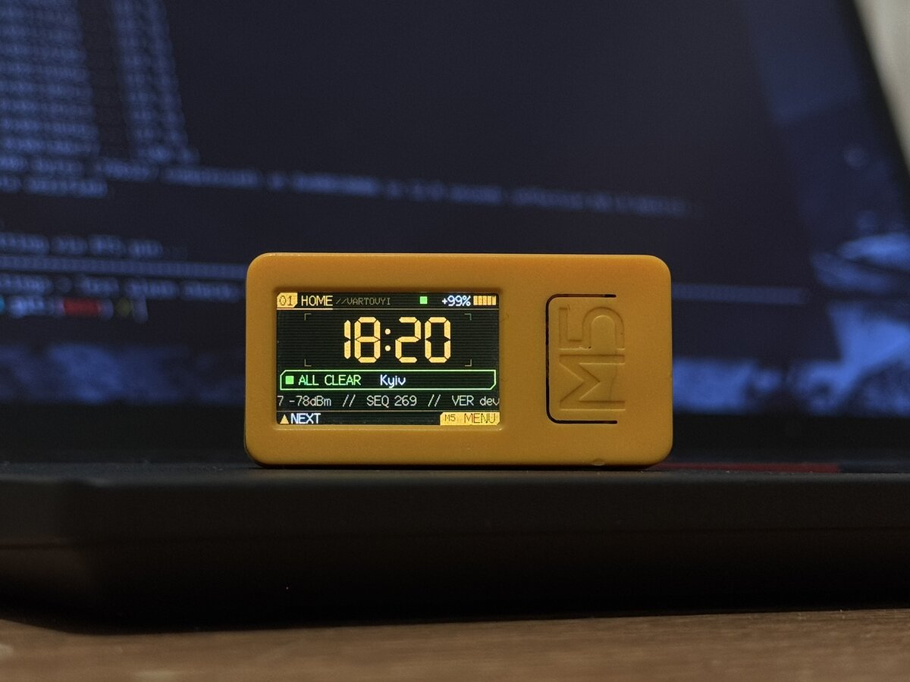

<div align="center">

# Vartovyi

**Повітряні тривоги вашої області на [M5StickC Plus2](https://docs.m5stack.com/en/core/M5StickC%20PLUS2)**<br>
Сирена, кольоровий екран, історія і статистика. Офіційні дані [api.ukrainealarm.com](https://api.ukrainealarm.com).

[](https://github.com/Skerpsh/vartovyi/actions/workflows/build.yml)
[](https://github.com/Skerpsh/vartovyi/releases/latest)
[](LICENSE)



**[Прошити стік у браузері →](https://skerpsh.github.io/vartovyi/)**

<sub>Air-raid alerts for any Ukrainian oblast and its raions on an M5StickC Plus2, from the official alert API. Flash it from the browser, set it up from your phone.</sub>

</div>

## Можливості

- Сирена при тривозі, окремий звук для балістики, тихіші сигнали для дронів і відбою.
- Будь-яка область України: стік показує її райони, а ви вибираєте, які з них стежити.
- Нічний режим, вимкнення звуку переворотом стіка екраном донизу.
- Інтерфейс у стилі кібердеку: 6 колірних тем (Orange, Cyan, Magenta, Violet, Blue, Ice), анімації меню й увімкнення. Тема перемикається в Menu > Theme.
- Історія та статистика тривог, рівень заряду, кілька Wi-Fi мереж за пріоритетом.
- Оновлення по Wi-Fi з автоматичним відкатом, якщо нова версія не запрацювала.

## Прошити стік

**Найпростіше:** відкрийте **https://skerpsh.github.io/vartovyi/** у Chrome або Edge на комп'ютері, підключіть стік USB-кабелем і натисніть «Прошити стік».

**Через PlatformIO:**
```sh
git clone https://github.com/Skerpsh/vartovyi && cd vartovyi
./flash.sh            # --erase також стирає збережені мережі й налаштування
```

## Перший запуск

Стік покаже QR-код мережі **Vartovyi**. Відскануйте його телефоном: відкриється сторінка налаштувань, де можна додати свій Wi-Fi (тільки 2,4 ГГц), вибрати область і її райони, нічний режим, гучність і яскравість.
Натисніть **Close setup**, і стік підключиться. Пізніше сторінка відкривається з меню: Settings > Phone setup. Область і райони можна змінити й на самому стіку: Settings > Oblast, Settings > Zones.

## Керування

Тримайте стік кнопкою M5 праворуч від екрана. Внизу кожного екрана підказка, що робить кожна кнопка.

| Кнопка | Дія |
|---|---|
| ▲ бічна зверху | далі: наступний екран або пункт меню |
| ▼ живлення знизу | назад: на крок вгору в меню, з інших екранів на HOME |
| M5 | меню, вибір |
| будь-яка | вимкнути сирену. Також можна перевернути стік екраном донизу |

Екрани: HOME, MAP (райони області), ACTIVE (активні тривоги), HISTORY, STATS (сьогодні і за тиждень), SYSTEM (мережа, зв'язок, версія).

## Оновлення

Нові версії з'являються в [Releases](https://github.com/Skerpsh/vartovyi/releases). На стіку: Settings > Update firmware, там же видно поточну версію.
Якщо нова прошивка за 5 хвилин не дістане сервер, стік сам повернеться до попередньої.

## Як це працює

```
api.ukrainealarm.com ──webhook + опитування──► міст (vps/peace_bridge.py) ──Caddy, https──► стік
```
Міст отримує підписані вебхуки й раз на 65 с звіряється з повним списком тривог, а результат пише в невеликий текстовий файл для кожної області. Стік читає файл своєї області кожні 3 секунди.

## Свій сервер

Потрібні Linux із systemd, [Caddy](https://caddyserver.com) з сайтом на `*.nip.io` або вашому домені і ключ API від ukrainealarm.com.
```sh
mkdir -p /etc/peace-stick && echo 'ВАШ_КЛЮЧ' > /etc/peace-stick/api-key
echo 'WEBHOOK_URL=https://ваш.сервер/peace-stick/webhook' > /etc/peace-stick/env
curl -fsSL https://raw.githubusercontent.com/Skerpsh/vartovyi/main/vps/update.sh | sh
```
Скрипт ставить міст, додає маршрути в Caddyfile і вмикає таймер, який щогодини забирає новий реліз (і міст, і прошивку для стіка).
Прошивку зберіть зі своєю адресою:
```sh
PLATFORMIO_BUILD_FLAGS="-DALERT_URL='\"https://ваш.сервер/peace-stick\"'" ./flash.sh
```

## Розробка

- `test/`: тести логіки стіка (`g++`) і моста (`python3 test/test_bridge.py`).
- `./deploy.sh`: ставить поточну робочу копію моста на сервер, щоб перевірити її до релізу.
- Реліз: `git tag v1.2.0 && git push --tags`. GitHub Actions збирає прошивку, публікує реліз і оновлює веб-прошивальник, а сервер підхоплює реліз протягом години.
